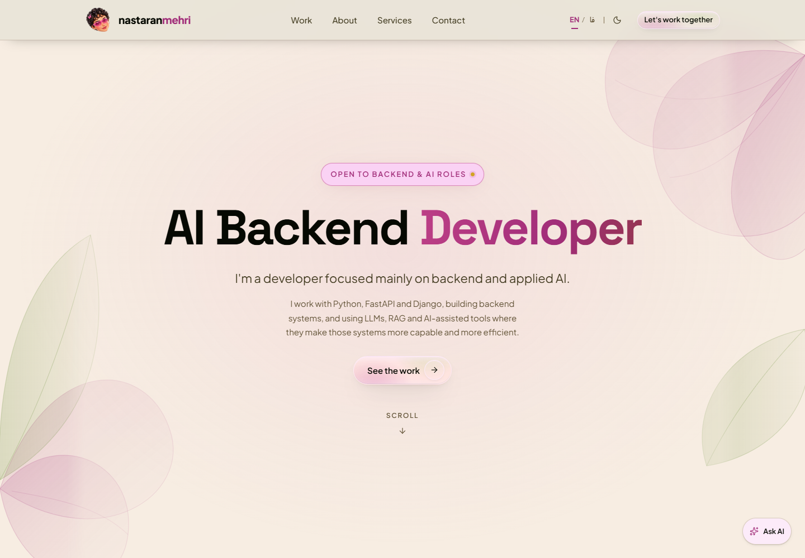

# Nastaran Mehri — Portfolio

A bilingual portfolio built as a working example of my backend and applied AI engineering:
a static-first website with a custom English/Persian RAG assistant, serverless APIs, and Redis-backed retrieval and persistence.

**[Visit the live portfolio](https://nastaran-mehri-portfolio.vercel.app/)**

Open **Ask AI** on the site to ask about my work, skills, or services and explore answers with source links.

## The engineering behind Ask AI

The assistant uses **Retrieval-Augmented Generation (RAG)** to answer from the portfolio's published content.
The retrieval, grounding, caching, and failure-handling pipeline is implemented in the project.

- **Content-derived knowledge:** the searchable corpus is built from the same content that renders the website, including project write-ups and engineering decisions.
- **Hybrid retrieval:** Gemini embeddings provide semantic search, combined with lexical search through Reciprocal Rank Fusion (RRF).
- **Cross-language retrieval:** questions search both English and Persian content; answers use the question's language and retain links to the original sources.
- **Grounding and answer verification:** generated factual claims and translations are checked against cited evidence before display; only verified factual answers enter the shared cache.
- **Deployment-aware indexing:** each deployment uses its matching corpus and private vector index, keeping previews, content updates, and rollbacks separate.
- **Context-aware follow-ups:** recent conversation helps interpret questions, while published content remains the source of portfolio facts.

The main flow is:

**Published content → chunking and embeddings → hybrid retrieval → answer generation → verification → cited response**

## Reliability and backend design

- **Provider failover:** generation can move between Gemini, Cloudflare Workers AI, and OpenRouter when a provider fails or reaches a quota.
- **Graceful retrieval degradation:** embedding or index failures can fall back to keyword search. Storage failure in the spending limiter instead fails closed.
- **Content-aware caching:** verified answers are cached in Redis and invalidated when portfolio content changes.
- **Bounded requests:** server-side validation, atomic rate limiting for Ask AI, and shared request deadlines control resource use.
- **Private operational data:** credentials and vector indexes stay server-side; diagnostic logs record timings and failure categories without question or answer text.
- **Durable contact handling:** messages are saved before notification delivery, so a notification failure does not discard an accepted message.

## Portfolio experience

- Independently authored English and Persian content, with right-to-left layouts for Persian.
- Responsive layouts, light and dark themes, and self-hosted fonts.
- Project presentations, background, services, a downloadable CV, and a contact form.
- Static-first rendering, with build checks for JavaScript budgets and logical CSS properties used by the bilingual layouts.

## Technologies

| Technology | Purpose |
| --- | --- |
| Astro + MDX | Static-first pages and structured project content |
| TypeScript + Zod | Typed application code and runtime/content validation |
| Gemini embeddings | Semantic retrieval across English and Persian content |
| Upstash Redis | Private vectors, verified-answer cache, rate limits, and contact persistence |
| Serverless functions on Vercel | Ask AI and contact APIs alongside the static site |
| CSS | Responsive layouts, semantic theme tokens, and right-to-left styling |

## Quality checks

The private codebase includes offline regression tests for retrieval, deployment isolation, provider/storage failures,
answer verification, conversation handling, and contact persistence. Separate live evaluation tools exercise
real retrieval and model responses; build checks enforce content and frontend constraints.

## About this repository

This is the public showcase for my portfolio. It contains a project overview and a screenshot.
The source code is maintained in a separate private repository.

## Ownership

© Nastaran Mehri. All rights reserved. The design, written content, and images are not licensed for reuse.
